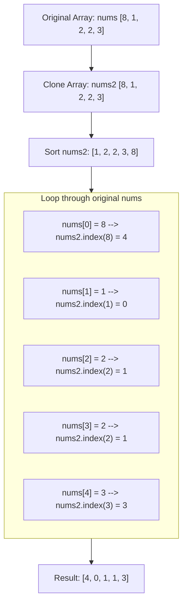

<h2><a href="https://leetcode.com/problems/how-many-numbers-are-smaller-than-the-current-number">0000. How Many Numbers Are Smaller Than The Current Number</a></h2>

<p>Given the array <code>nums</code>, for each <code>nums[i]</code> find out how many numbers in the array are smaller than it. That is, for each <code>nums[i]</code> you have to count the number of valid <code>j's</code>&nbsp;such that&nbsp;<code>j != i</code> <strong>and</strong> <code>nums[j] &lt; nums[i]</code>.</p>

<p>Return the answer in an array.</p>

<p>&nbsp;</p>
<p><strong class="example">Example 1:</strong></p>

<pre><strong>Input:</strong> nums = [8,1,2,2,3]
<strong>Output:</strong> [4,0,1,1,3]
<strong>Explanation:</strong> 
For nums[0]=8 there exist four smaller numbers than it (1, 2, 2 and 3). 
For nums[1]=1 does not exist any smaller number than it.
For nums[2]=2 there exist one smaller number than it (1). 
For nums[3]=2 there exist one smaller number than it (1). 
For nums[4]=3 there exist three smaller numbers than it (1, 2 and 2).
</pre>

<p><strong class="example">Example 2:</strong></p>

<pre><strong>Input:</strong> nums = [6,5,4,8]
<strong>Output:</strong> [2,1,0,3]
</pre>

<p><strong class="example">Example 3:</strong></p>

<pre><strong>Input:</strong> nums = [7,7,7,7]
<strong>Output:</strong> [0,0,0,0]
</pre>

<p>&nbsp;</p>
<p><strong>Constraints:</strong></p>

<ul>
	<li><code>2 &lt;= nums.length &lt;= 500</code></li>
	<li><code>0 &lt;= nums[i] &lt;= 100</code></li>
</ul>


---

# 🛍️ How-Many-Numbers-Are-Smaller-Than-The-Current-Number | Explained

## Approach 1: Sort and Linear Scan Lookup (`list.index`)

### Intuition
Imagine a group of students lining up for a class photo based on height, ordered from shortest to tallest. If you want to know how many classmates are strictly shorter than you, you simply walk up to the line, find where someone of your exact height first appears, and count everyone in front of them. Because the line is ordered from shortest to tallest, your index (0-indexed position) in that line directly tells you the count of people shorter than you.

This solution applies that exact principle: sort a copy of the numbers, and the index of the first occurrence of each number in the sorted list represents the count of elements smaller than it.

### Algorithm Visualized



### Approach
1. **Duplicate the Array:** Create an independent copy of `nums` named `nums2` so the original order is preserved.
2. **Sort the Duplicate:** Sort `nums2` in non-decreasing order using Python's built-in Timsort.
3. **Map Relative Counts:** Iterate over each number in the original `nums` list.
4. **Find First Occurrence:** Use Python's built-in `.index()` method on `nums2`. Because `.index()` returns the *first* index where the element appears, duplicates do not inflate the count (e.g., if `2` appears at index 1 and index 2, `.index(2)` returns `1`, accurately indicating that only 1 element is strictly smaller than `2`).
5. **Collect and Return:** Append each resolved index to the `results` list and return it.

### Detailed Code Analysis

```python
class Solution:
    def smallerNumbersThanCurrent(self, nums: list[int]) -> list[int]:
        nums2 = nums.copy()
```
* `nums.copy()` performs a shallow copy of the list. We need this because sorting in Python with `.sort()` mutates the list in place, which would destroy the original ordering required for the final answer.

```python
        nums2.sort()
```
* Calls Python's native in-place sorting algorithm (Timsort). After this step, `nums2` is sorted in ascending order. Any element at index $k$ has strictly smaller elements preceding it if it is the first occurrence of that value.

```python
        results = []
        for i in nums:
            results.append(nums2.index(i))
        return results
```
* `results = []`: Initializes an empty array to accumulate our counts.
* `for i in nums:`: Traverses the original unsorted list element by element.
* `nums2.index(i)`: **Key operational detail:** Python's `list.index(value)` performs a linear search from index `0` until it finds the first match for `i`. Because `nums2` is sorted, this first occurrence index matches the exact count of numbers smaller than `i`.
* `results.append(...)`: Appends the discovered index to our output list.
* `return results`: Returns the accumulated list matching the input's original indices.

### Code
```python
class Solution:
    def smallerNumbersThanCurrent(self, nums: list[int]) -> list[int]:
        nums2 = nums.copy()
        nums2.sort()
        results = []
        for i in nums:
            results.append(nums2.index(i))
        return results
```

### Complexity
- **Time Complexity:** $\mathcal{O}(n^2)$
  - Cloning `nums` takes $\mathcal{O}(n)$ time.
  - Sorting `nums2` takes $\mathcal{O}(n \log n)$ time.
  - The `for` loop runs $n$ times. Inside the loop, `nums2.index(i)` executes a linear search over `nums2`, taking $\mathcal{O}(n)$ time in the average and worst case.
  - Total time: $\mathcal{O}(n) + \mathcal{O}(n \log n) + \mathcal{O}(n \cdot n) = \mathcal{O}(n^2)$.
- **Space Complexity:** $\mathcal{O}(n)$
  - `nums2` requires $\mathcal{O}(n)$ space to store the duplicate list.
  - `results` requires $\mathcal{O}(n)$ space to hold the output values.
  - Timsort requires up to $\mathcal{O}(n)$ auxiliary memory during sorting.

---

## 🕵️‍♂️ Follow-up Questions (Optional)

1. **How can you optimize the lookup step to avoid the $\mathcal{O}(n^2)$ worst-case time?**
   - Instead of calling `nums2.index(i)` inside the loop, traverse the sorted list `nums2` once and store each number's first seen index in a hash map (`dict`). Then, query the hash map in $\mathcal{O}(1)$ time per element in `nums`. This drops the overall time complexity from $\mathcal{O}(n^2)$ to $\mathcal{O}(n \log n)$.

2. **Can this problem be solved in linear time $\mathcal{O}(n)$?**
   - Yes, using **Counting Sort / Prefix Sums**. Since LeetCode constraints specify that $0 \le nums[i] \le 100$, you can allocate a fixed-size frequency array of size 101. After counting frequencies, compute the prefix sums where `prefix[v]` represents how many numbers are smaller than `v`. This achieves $\mathcal{O}(n + K)$ time complexity and $\mathcal{O}(K)$ auxiliary space, where $K = 101$.